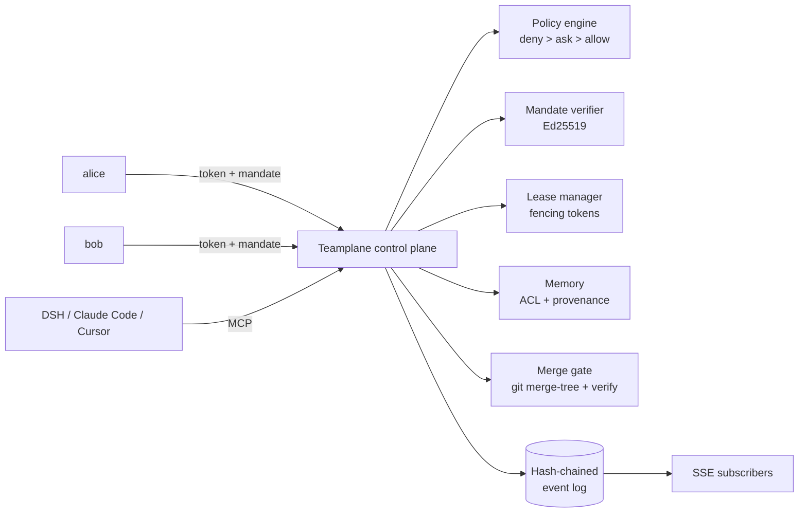

# Teamplane

**A deterministic control plane for multi-user agent teams.**

[](https://github.com/JustinSian/teamplane/actions/workflows/ci.yml)
[](LICENSE)
[](package.json)

Your agents share a repository, not a brain.

Teamplane gives every teammate and every agent a **signed mandate**, a **lease** on the files it touches, a **permissioned memory** it may read, and an **auditable merge gate**. It does not watch every conversation. It subscribes to structured events.

> 中文说明见 [README.zh.md](README.zh.md).

---

## The problem

A single agent is now good enough that the bottleneck moved: **one person can only track three to five active sessions**. Hand every teammate an agent and the bottleneck gets worse — duplicated investigations, stale branches, conflicting edits, and a shared chat history nobody is allowed to read.

The usual answer is an omniscient master agent that watches every session and approves every action. That answer is expensive, unverifiable, and a single prompt injection away from being the weakest link.

Teamplane takes the opposite position:

1. **Mandates, not omniscience.** Authority is a signed, narrow, expiring capability bound to one principal and one task.
2. **Deterministic gates, not model judgement.** Policy decisions are a pure function. The model may propose; it never disposes.
3. **Events, not transcripts.** Coordination uses typed events (`lease.denied`, `approval.requested`, `submit.rejected`) and curated memory fragments — never raw conversation logs.

---

## 60-second demo

```bash
git clone https://github.com/JustinSian/teamplane.git
cd teamplane
npm install
npm run build
npm run demo
```

The demo creates a real git repository, three principals (alice, bob, carol), three worktrees, signed mandates and a control plane on an ephemeral port. It then proves, step by step:

- carol cannot write `src/auth.ts` — her mandate only covers `docs/`;
- bob cannot lease a file alice holds — the conflict is a `409` with the holder and expiry;
- a force-push returns `ask`, becomes `allow` only with a one-shot owner approval, and returns to `ask` after it is consumed;
- a failing verification command stops the merge even when the branch is textually clean;
- the hash-chained audit log verifies.

A full transcript is written to `demo/out/report.md`.

---

## How it works



Five planes, one process:

| Plane | What it owns | What it refuses to do |
|---|---|---|
| Identity & authority | principals, roles, signed mandates | trust a model's claim of permission |
| Memory | curated fragments, visibility, provenance, conflict events | store or share transcripts |
| Coordination | tasks, typed resource leases, fencing | decide conflicts by opinion |
| Execution | per-task git worktrees, `.teamplane/context.json` | let agents write outside their worktree |
| Audit | append-only hash-chained events | mutate history |

### Two-gate authorization

Every action passes two independent checks:

1. **Policy** — is this principal, with these roles, allowed to perform this action on this resource? (`deny > ask > allow > default deny`)
2. **Mandate** — does *this task's* signed mandate cover this path, action, branch and memory namespace?

Only then does the action proceed. A third gate covers writes: an active lease must cover the file.

### What a mandate looks like

```
header.payload.signature          # Ed25519, JWT-like but not JWT
claims = {
  id, issuer, subject, task,
  scope: { paths, actions, branches, memory },
  limits: { maxWrites, expiresAt },
  policyVersion, iat, exp, nonce
}
```

Mandates **attenuate**: a derived mandate must be a strict subset of its parent — narrower paths, fewer actions, shorter expiry. Expansion fails closed. Verification is offline with the public key; revocation is an event.

### Leases are typed, not guessed

```
file:src/auth.ts     dir:src/auth     branch:main     memory:team/auth
```

`file` and `dir` keys have decidable containment; a `dir` lease covers every file below it. Every acquisition increments a **fencing token**, so a stale holder can never be mistaken for the current one. Leases expire; renewals are holder-only.

### Memory is curated, never scraped

A fragment is at most 4 KiB and must declare `kind`, `topic`, `visibility`, and provenance. Raw transcripts are not accepted. Secrets are rejected before they land (AWS keys, GitHub/OpenAI tokens, PEM private keys, bearer tokens, password assignments).

Reads are projected through ACLs: `private`, `team`, or `role:<role>`. Two contradictory fragments on the same topic emit a `memory.conflict` event instead of silently picking a winner.

---

## Quickstart

```bash
npm install -g teamplane      # or: npm install && npm run build && npm link

mkdir acme && cd acme
git init -b main && git commit --allow-empty -m "seed"
teamplane init --name acme --owner alice
# copy the token printed once
export TEAMPLANE_TOKEN="tp_..."

teamplane serve                # http://127.0.0.1:7317
```

In another shell:

```bash
export TEAMPLANE_TOKEN="tp_..."
teamplane user add --name bob --role maintainer
teamplane task create --title "refactor auth" --repo .
teamplane mandate issue --subject <bob-id> --task <task-id> --paths src/auth.ts --ttl 1h
teamplane task start <task-id> --id <mandate-id>
teamplane lease acquire --key file:src/auth.ts --task <task-id> --ttl 15m
teamplane submit <task-id> --verify "npm test" --merge
teamplane audit verify
```

The web console at `http://127.0.0.1:7317/` shows active tasks, live leases, pending approvals and the event feed. Paste the principal token once; it stays in `localStorage`.

---

## Connect DeepSeek Harness (DSH)

Teamplane speaks MCP over stdio **and** Streamable HTTP. DSH's built-in `dsh-mcp-client` needs one row:

```bash
teamplane dsh print-config
```

```yaml
- id: mcp-teamplane
  name: '@deepseek-ai/dsh-mcp-client'
  config:
    serverName: teamplane
    transport: stdio
    command: npx
    args: ['-y', 'teamplane', 'mcp']
    env:
      TEAMPLANE_URL: http://127.0.0.1:7317
      TEAMPLANE_TOKEN: !!js process.env.TEAMPLANE_TOKEN
```

The agent then gets ten tools: `tp_whoami`, `tp_task_start`, `tp_lease_acquire`, `tp_lease_release`, `tp_memory_put`, `tp_memory_search`, `tp_approval_request`, `tp_events_poll`, `tp_submit`, `tp_policy_explain`.

For a host-level write guard, `dsh-plugin/` contains an experimental `dsh-teamplane-guard` bundle. It registers a **synchronous** `ctx.tools.guard` that fails closed when a write leaves the mandate or the worktree, or when a shell command matches a denied pattern. No model and no network call are in that path. See [docs/dsh.md](docs/dsh.md).

---

## What Teamplane is not

- Not an LLM. It never calls a model at decision time.
- Not a chat supervisor. It never ingests session transcripts.
- Not a distributed system. One control plane, one writer, one SQLite-free event log.
- Not a GitHub App. v0.1 operates on local or shared bare repositories.
- Not a replacement for code review. It gates *who may merge what*, not *whether the code is good*.

---

## Design notes

The full rationale, prior art and threat model live in:

- [docs/architecture.md](docs/architecture.md) — five planes, sequence diagrams, invariants
- [docs/threat-model.md](docs/threat-model.md) — prompt injection, confused deputy, lease bypass, inference leaks
- [docs/design-notes.md](docs/design-notes.md) — why not an omniscient master; related work
- [docs/policy.md](docs/policy.md) — the policy language
- [docs/api.md](docs/api.md) — HTTP surface
- [docs/mcp.md](docs/mcp.md) — MCP tools
- [docs/demo.md](docs/demo.md) — what the demo proves

Related work that shaped the design: Collaborative Memory (ICML'25), MERGEGYM, ScopeGate, DelegateGuard, and DeepSeek Harness's Super-agent architecture. Teamplane extends the Super-agent *Mandate* from one user to many principals and moves the gate out of the model.

---

## Status

`0.1.0` — research-grade, single-node, pre-1.0. The event log is O(n) on startup; snapshots mitigate, rotation is on the roadmap. Interfaces may change before `1.0`.

If you build on it, pin a commit and read [SECURITY.md](SECURITY.md).

## License

MIT. See [LICENSE](LICENSE).
