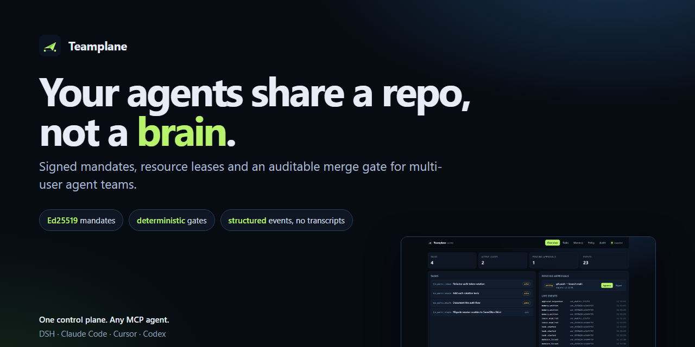
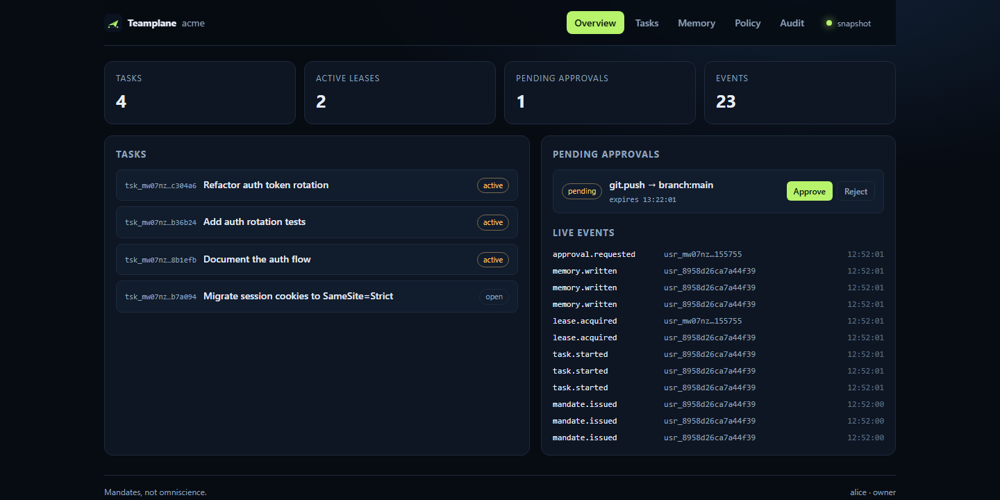
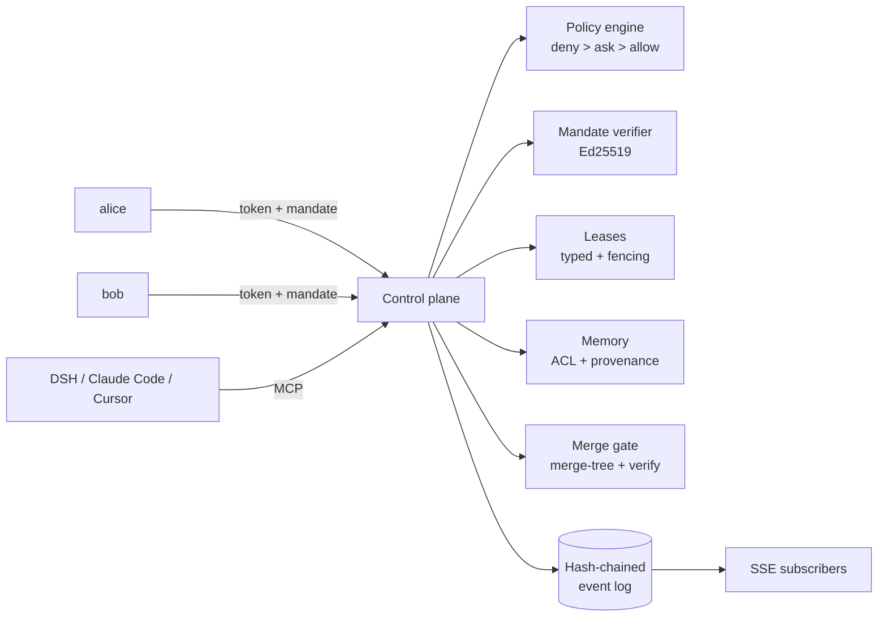

# Teamplane

**Your agents share a repo, not a brain.**

[](https://github.com/JustinSian/Teamplane/actions/workflows/ci.yml)
[](LICENSE)
[](package.json)
[](STATUS.md)



Teamplane is a **multi-principal control plane for teams of humans and agents**. It gives every teammate and every agent a signed **mandate**, a **lease** on the files it touches, a **permissioned memory** it may read, and an auditable **merge gate**. It does not watch every conversation. It subscribes to structured events.

> 中文说明见 [README.zh.md](README.zh.md). The readiness matrix is in [STATUS.md](STATUS.md).

---

## Try it in 60 seconds

```bash
git clone https://github.com/JustinSian/Teamplane.git
cd Teamplane
npm install && npm run build && npm link
teamplane playground --open
```

A seeded team appears in your browser: four tasks, two live leases, one pending approval, a memory store, and a live event feed. Click **Approve** and watch the event stream change.

No model keys. No Docker. No cloud account.

Prefer the command line? `npm run demo` runs the same scenario headlessly and writes `demo/out/report.md`.



---

## The problem

A single agent is good enough that the bottleneck moved: **one person can only track three to five active sessions**. Hand every teammate an agent and it gets worse — duplicated investigations, stale branches, conflicting edits, and a chat history nobody is allowed to read.

The usual answer is an omniscient supervisor agent that watches every session and approves every action. It is over-privileged, unverifiable, and one prompt injection away from being the weakest link.

Teamplane takes the opposite position:

1. **Mandates, not omniscience.** Authority is a signed, narrow, expiring capability bound to one principal and one task.
2. **Deterministic gates, not model judgement.** The model may propose; the policy engine, mandate verifier and lease manager decide. None of them calls a model.
3. **Events, not transcripts.** Coordination uses typed events and curated memory fragments with provenance and ACLs.

---

## How it works



Five planes, one process:

| Plane | Owns | Refuses |
|---|---|---|
| Identity & authority | principals, roles, signed mandates | trusting a model's claim of permission |
| Memory | curated fragments, visibility, provenance, conflicts | storing or sharing transcripts |
| Coordination | tasks, typed leases, fencing tokens | deciding conflicts by opinion |
| Execution | per-task git worktrees and `.teamplane/context.json` | letting agents write outside their worktree |
| Audit | append-only hash-chained events | mutating history |

### Two gates and a lease

Every action passes:

1. **Policy** — is this principal, with these roles, allowed to perform this action on this resource? (`deny > ask > allow > default deny`)
2. **Mandate** — does *this task's* signed mandate cover this path, action, branch and memory namespace?
3. **Lease** — for writes, does an active lease cover the file?

A force push to `main` is `ask`: it becomes `allow` only with a one-shot owner approval bound to the action hash, and returns to `ask` after consumption. A replay is rejected.

### What a mandate looks like

```
header.payload.signature          # Ed25519, JWT-like but not JWT
claims = {
  id, issuer, subject, task,
  scope: { paths, actions, branches, memory },
  limits: { maxWrites, expiresAt },
  policyVersion, iat, exp, nonce
}
```

Derivation only narrows — narrower paths, fewer actions, shorter expiry. Expansion fails closed. Verification is offline; revocation is an event.

### Leases are typed, not guessed

```
file:src/auth.ts     dir:src/auth     branch:main     memory:team/auth
```

`dir` containment is decidable, every acquisition increments a **fencing token**, and expired leases cannot be renewed. The merge gate re-checks changed files against leases, then runs `git merge-tree --write-tree` and your verification commands before merging.

---

## Evidence, not adjectives

| Claim | Command / result |
|---|---|
| Coordination invariants hold | `npm test` — **29/29** |
| End-to-end behaviour | `npm run demo` — **16/16** steps, 2.7 s |
| MCP on both transports | `npm run mcp:smoke` — 10 tools |
| One winner per contended lease | 50 concurrent requests: **1 × 201, 49 × 409** |
| Distinct resources do not block | 50 concurrent keys: **50 × 201** |
| Decision latency | **0.59 ms** per `/v1/authorize` (loopback, not capacity) |
| Coverage | **76.4% lines / 64.8% branches** |
| Package installs cleanly | `npm pack` + install into a clean prefix |

### What a lease costs

A `file:` lease is deliberately conservative. In a 30-trial replay per mode, it caught **30/30** textual conflicts — and also blocked **30/30** clean same-file edits that the merge gate would have allowed. The merge gate is the precise check; the lease is the cheap early signal. Full method and threats to validity in [bench/](bench/README.md).

Everything is self-reported and reproducible; [STATUS.md](STATUS.md) lists what has **not** been evaluated (no real model loop, no multi-machine soak, no red team, no independent benchmark).

---

## Connect DeepSeek Harness

Teamplane speaks MCP over stdio and Streamable HTTP. DSH's `dsh-mcp-client` needs one row:

```bash
teamplane dsh print-config
```

```yaml
- id: mcp-teamplane
  name: '@deepseek-ai/dsh-mcp-client'
  config:
    serverName: teamplane
    transport: stdio
    command: npx
    args: ['-y', 'teamplane', 'mcp']
    env:
      TEAMPLANE_URL: http://127.0.0.1:7317
      TEAMPLANE_TOKEN: !!js process.env.TEAMPLANE_TOKEN
```

The agent gets ten tools: `tp_whoami`, `tp_task_start`, `tp_lease_acquire`, `tp_lease_release`, `tp_memory_put`, `tp_memory_search`, `tp_approval_request`, `tp_events_poll`, `tp_submit`, `tp_policy_explain`.

A shared control plane is the same row with `transport: streamable-http` and `url: http://127.0.0.1:7317/mcp`. See [docs/mcp.md](docs/mcp.md) and [docs/dsh.md](docs/dsh.md).

### Host guard (experimental)

`dsh-plugin/` registers a synchronous `ctx.tools.guard` that fails closed when a write leaves the mandate or the worktree. No model, no network. It is tested inside the real `@deepseek-ai/dsh-tools` pipeline (a denied write returns a tool error), but not yet inside a full DSH session — read [docs/dsh.md](docs/dsh.md) before installing.

---

## Verify an audit chain in CI

```yaml
- name: Verify the Teamplane event log
  uses: JustinSian/Teamplane@v0.2.7
  with:
    control-plane-url: ${{ vars.TEAMPLANE_URL }}
    token: ${{ secrets.TEAMPLANE_TOKEN }}
```

The action fails closed if the endpoint is unreachable or the hash chain is broken. See [action.yml](action.yml) and [examples/](examples/).

---

## Install for real

```bash
npm install && npm run build && npm link

mkdir acme && cd acme
git init -b main && git commit --allow-empty -m "seed"
teamplane init --name acme --owner alice
export TEAMPLANE_TOKEN="tp_..."     # printed once
teamplane serve                      # http://127.0.0.1:7317
```

Then, from another shell:

```bash
teamplane user add --name bob --role maintainer
teamplane task create --title "refactor auth" --repo .
teamplane mandate issue --subject <bob-id> --task <task-id> --paths src/auth.ts --ttl 1h
teamplane task start <task-id> --id <mandate-id>
teamplane task launch <task-id> -- dsh     # or: -- node worker.mjs
teamplane lease acquire --key file:src/auth.ts --task <task-id> --ttl 15m
teamplane submit <task-id> --verify "npm test" --merge
teamplane audit verify
```

---

## Docs

| | |
|---|---|
| [STATUS.md](STATUS.md) | what works, what is partial, what has not been measured |
| [PRODUCT.md](PRODUCT.md) | who it is for, journeys, metrics, why it can be a star project |
| [ROADMAP.md](ROADMAP.md) | v0.2 product surface → v1.0 stability |
| [docs/why.md](docs/why.md) | the argument against the supervisor agent |
| [docs/architecture.md](docs/architecture.md) | five planes, sequence diagrams, invariants |
| [docs/threat-model.md](docs/threat-model.md) | prompt injection, confused deputy, lease bypass, inference |
| [docs/design-notes.md](docs/design-notes.md) | prior art and what would falsify the design |
| [docs/comparison.md](docs/comparison.md) | Dust, Tencent Team Memory, Super-agent, plain subagents |
| [docs/launch.md](docs/launch.md) | the launch argument, with evidence and caveats |
| [docs/policy.md](docs/policy.md) · [docs/api.md](docs/api.md) · [docs/mcp.md](docs/mcp.md) | contracts |

Related work that shaped this: Collaborative Memory (ICML'25), MERGEGYM, ScopeGate, DelegateGuard, and DeepSeek Harness's Super-agent. Teamplane extends the Super-agent *Mandate* from one user to many principals and moves the gate out of the model.

---

## Status

`0.2.7` — **research preview**, single node, pre-1.0. The event log is O(n) on startup; snapshots mitigate, rotation is on the roadmap. Interfaces may change before `1.0`.

If you build on it, pin a commit and read [SECURITY.md](SECURITY.md) and [STATUS.md](STATUS.md).

## License

MIT. See [LICENSE](LICENSE).
