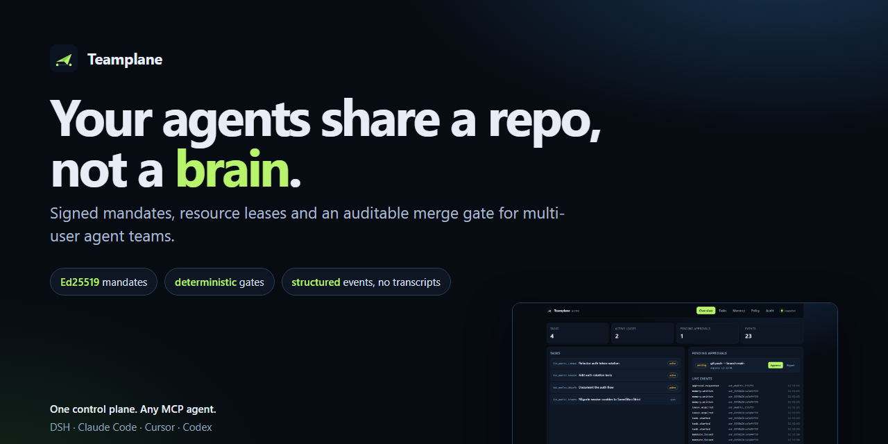
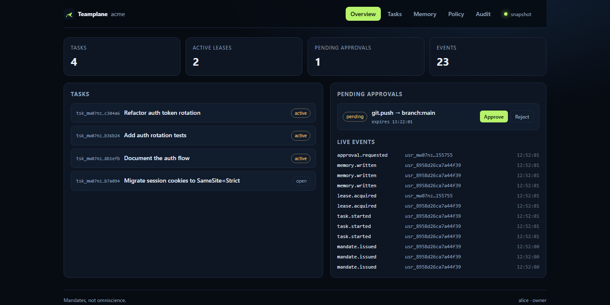

# Teamplane

**多主体 Agent 团队的确定性控制平面。**

> English: [README.md](README.md) · 状态与边界见 [STATUS.md](STATUS.md)



你的 Agent 们共享一个仓库，但不共享一个大脑。

Teamplane 给每个团队成员和每个 Agent 发一张**签名 Mandate（授权）**，给它正在改的文件上**租约（Lease）**，给它一份**带权限的团队记忆**，以及一道**可审计的合并门禁**。它不监控所有会话，只订阅结构化事件。

---

## 它解决什么问题

单个 Agent 已经足够强，瓶颈转移了：**一个人通常只能同时跟进 3～5 个活跃会话**。给每个同事配一个 Agent，问题只会放大——重复调查、过期分支、互相覆盖、以及一份谁都不该读的共享聊天记录。

常见答案是造一个全知主控 Agent，盯着所有会话、审批所有操作。这个答案昂贵、不可验证，而且一次提示词注入就可能变成最薄弱的环节。

Teamplane 站在反面：

1. **要 Mandate，不要全知。** 权限是一张签名、狭窄、会过期的能力凭证，绑定一个主体和一个任务。
2. **要确定性门禁，不要模型判断。** 策略决策是纯函数。模型可以建议，但从不裁决。
3. **要事件，不要会话转录。** 协作用类型化事件（`lease.denied`、`approval.requested`、`submit.rejected`）和精选记忆片段，不落原始对话。

---

## 60 秒体验

```bash
git clone https://github.com/JustinSian/Teamplane.git
cd Teamplane
npm install && npm run build && npm link
teamplane playground --open
```

浏览器里会出现一个已经跑起来的团队：四个工单、两个活跃租约、一个待审批、一份团队记忆和实时事件流。点一下 **Approve**，事件流会立刻变化。

没有模型 key，没有 Docker，没有云账号。



命令行版本：`npm run demo` 会无头跑同一套场景，并把报告写到 `demo/out/report.md`。

演示会创建一个真实 git 仓库、三个主体（alice / bob / carol）、三个 worktree、三张签名 Mandate，并在临时端口起一个控制平面，逐步证明：

- carol 写不了 `src/auth.ts`——她的 Mandate 只覆盖 `docs/`；
- bob 抢不到 alice 持有的文件租约——冲突是 `409`，带持有者和到期时间；
- force push 返回 `ask`，只有一次性 owner 审批才变 `allow`，审批消费后重新变回 `ask`；
- 校验命令失败时，即使分支在文本上干净，合并也会被拦下；
- 哈希链审计日志校验通过。

完整过程写入 `demo/out/report.md`。

---

## 工作方式

```
alice ──token+mandate──┐
bob   ──token+mandate──┤        ┌──────────────┐
DSH   ──────MCP────────┼──────▶ │ 控制平面      │
Cursor ─────MCP────────┘        │ policy       │
                                │ mandate 校验  │
                                │ lease 管理    │
                                │ memory ACL   │
                                │ merge gate   │
                                └──────┬───────┘
                                       ▼
                              哈希链事件日志 ──▶ SSE
```

五个平面，一个进程：

| 平面 | 负责 | 拒绝做 |
|---|---|---|
| 身份与授权 | 主体、角色、签名 Mandate | 相信模型自称有权限 |
| 记忆 | 精选片段、可见性、来源、冲突事件 | 存储或共享会话转录 |
| 协调 | 工单、类型化资源租约、fencing | 用“看法”裁决冲突 |
| 执行 | 每任务独立 git worktree、`.teamplane/context.json` | 允许 Agent 写出 worktree |
| 审计 | 只追加、哈希链事件 | 修改历史 |

### 两段式授权

每个动作过两道独立检查：

1. **Policy**——这个主体、这些角色，能否对这个资源做这个动作？（`deny > ask > allow > 默认拒绝`）
2. **Mandate**——*这张工单*的签名授权是否覆盖这个路径、动作、分支和记忆命名空间？

写操作还有第三道：必须有活跃租约覆盖该文件。

### Mandate 长什么样

```
header.payload.signature          # Ed25519，类 JWT 但不是 JWT
claims = {
  id, issuer, subject, task,
  scope: { paths, actions, branches, memory },
  limits: { maxWrites, expiresAt },
  policyVersion, iat, exp, nonce
}
```

Mandate 只能**衰减**：派生授权必须是父授权的严格子集——路径更窄、动作更少、有效期更短。扩权一律失败。校验可离线用公钥完成；撤销是一条事件。

### 租约是类型化的，不靠猜

```
file:src/auth.ts     dir:src/auth     branch:main     memory:team/auth
```

`file` 与 `dir` 的包含关系可判定，`dir` 租约覆盖其下所有文件。每次获取递增 **fencing token**，过期持有者永远不会被误认成当前持有者。租约到期自动失效，续租仅限持有者。

### 记忆是精选的，不是抓来的

一个片段最多 4 KiB，必须声明 `kind`、`topic`、`visibility` 和来源。**不接受原始会话转录**。密钥在落库前被拒绝（AWS key、GitHub/OpenAI token、PEM 私钥、Bearer token、密码赋值）。

读取按 ACL 投影：`private`、`team` 或 `role:<role>`。同一 topic 出现两条矛盾片段时，发出 `memory.conflict` 事件，而不是悄悄选一个赢家。

---

## 快速开始

```bash
npm install && npm run build && npm link   # 在本仓库目录执行

mkdir acme && cd acme
git init -b main && git commit --allow-empty -m "seed"
teamplane init --name acme --owner alice
# 复制只显示一次的 token
export TEAMPLANE_TOKEN="tp_..."

teamplane serve                # http://127.0.0.1:7317
```

另开一个终端：

```bash
export TEAMPLANE_TOKEN="tp_..."
teamplane user add --name bob --role maintainer
teamplane task create --title "refactor auth" --repo .
teamplane mandate issue --subject <bob-id> --task <task-id> --paths src/auth.ts --ttl 1h
teamplane task start <task-id> --id <mandate-id>
teamplane lease acquire --key file:src/auth.ts --task <task-id> --ttl 15m
teamplane submit <task-id> --verify "npm test" --merge
teamplane audit verify
```

控制台在 `http://127.0.0.1:7317/`，显示活跃工单、租约、待审批和实时事件流。token 只存在浏览器 `localStorage`。

---

## 接入 DeepSeek Harness

Teamplane 同时支持 stdio 和 Streamable HTTP 两种 MCP 传输。DSH 自带的 `dsh-mcp-client` 只加一行配置：

```bash
teamplane dsh print-config
```

```yaml
- id: mcp-teamplane
  name: '@deepseek-ai/dsh-mcp-client'
  config:
    serverName: teamplane
    transport: stdio
    command: npx
    args: ['-y', 'teamplane', 'mcp']
    env:
      TEAMPLANE_URL: http://127.0.0.1:7317
      TEAMPLANE_TOKEN: !!js process.env.TEAMPLANE_TOKEN
```

Agent 会拿到十个工具：`tp_whoami`、`tp_task_start`、`tp_lease_acquire`、`tp_lease_release`、`tp_memory_put`、`tp_memory_search`、`tp_approval_request`、`tp_events_poll`、`tp_submit`、`tp_policy_explain`。

如果要在宿主层做写入门禁，`dsh-plugin/` 里有一个实验性的 `dsh-teamplane-guard` bundle：注册**同步**的 `ctx.tools.guard`，写入越出 Mandate 或 worktree、或 shell 命中禁用命令时直接拒绝。这条路径没有模型、没有网络调用。详见 [docs/dsh.md](docs/dsh.md)。

---

## 它不是什么

- 不是 LLM。决策时不调用任何模型。
- 不是聊天监管器。从不摄入会话转录。
- 不是分布式系统。单个控制平面、单写者、无 SQLite 的事件日志。
- 不是 GitHub App。v0.1 只操作本地或共享 bare 仓库。
- 不替代代码评审。它门控“谁能合并什么”，不判断“代码好不好”。

---

## 现状与证据

| 声明 | 证据 |
|---|---|
| 协调不变量成立 | `npm test` — **25/25** |
| 端到端行为 | `npm run demo` — **16/16** 步，2.7 秒 |
| MCP 双传输 | `npm run mcp:smoke` — 10 个工具 |
| 同一租约只有一个赢家 | 50 并发：**1 × 201，49 × 409** |
| 不同资源互不阻塞 | 50 个不同 key：**50 × 201** |
| 决策延迟 | `/v1/authorize` **0.59 ms/次**（本机 loopback） |
| 覆盖率 | 行 **76.4%** / 分支 **64.8%** |

这些是自测数据，可复现；**没有**做真实模型循环、多机 soak、红队和独立基准。完整清单见 [STATUS.md](STATUS.md)，产品定义见 [PRODUCT.md](PRODUCT.md)，路线图见 [ROADMAP.md](ROADMAP.md)。

## 设计文档

- [docs/architecture.md](docs/architecture.md) — 五平面、时序、不变量
- [docs/threat-model.md](docs/threat-model.md) — 提示词注入、confused deputy、租约绕过、推断泄露
- [docs/design-notes.md](docs/design-notes.md) — 为什么不做全知主控；相关工作
- [docs/policy.md](docs/policy.md) — 策略语言
- [docs/api.md](docs/api.md) — HTTP 接口
- [docs/mcp.md](docs/mcp.md) — MCP 工具
- [docs/demo.md](docs/demo.md) — 演示到底证明了什么

影响这套设计的工作：Collaborative Memory（ICML'25）、MERGEGYM、ScopeGate、DelegateGuard，以及 DeepSeek Harness 的 Super-agent 架构。Teamplane 把 Super-agent 的 **Mandate 从单用户扩展到多主体**，并把门控从模型手里拿回到确定性策略层。

---

## 状态

`0.1.0`——研究级、单节点、pre-1.0。启动时事件日志是 O(n)，有快照缓解，日志轮转在路线图上。`1.0` 前接口可能变化。

如果要基于它开发，请固定 commit，并阅读 [SECURITY.md](SECURITY.md)。

## 许可证

MIT，见 [LICENSE](LICENSE)。
