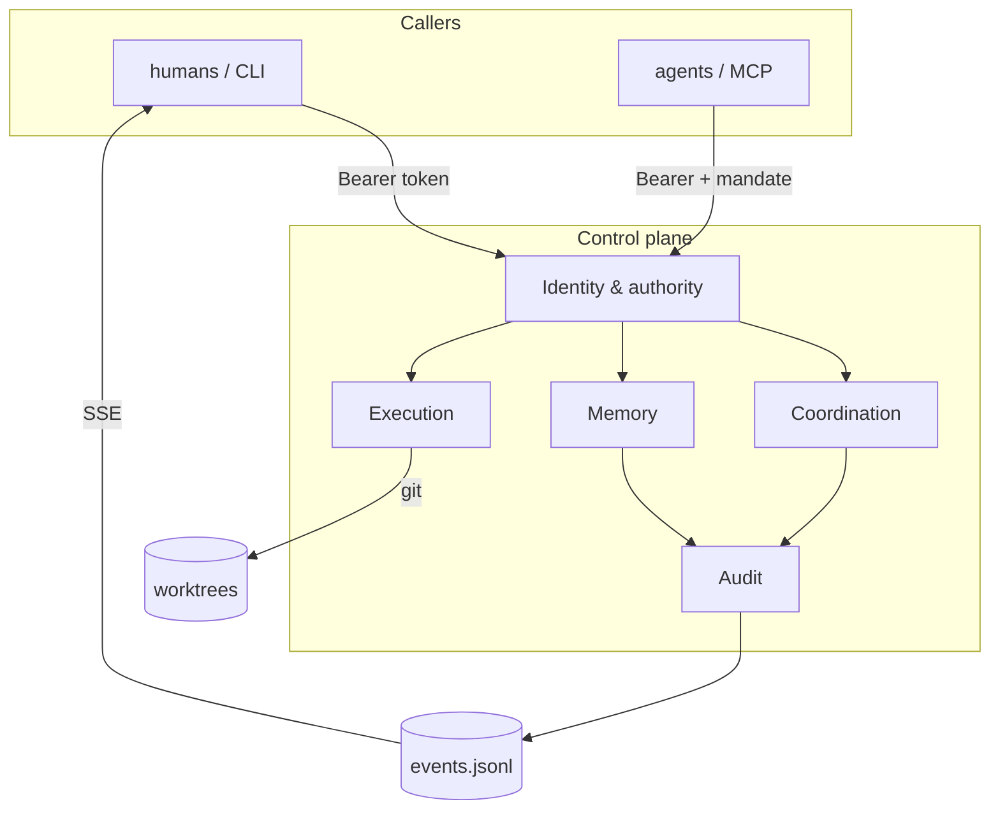
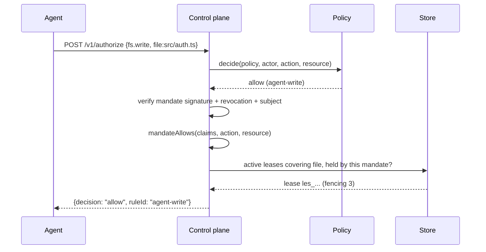
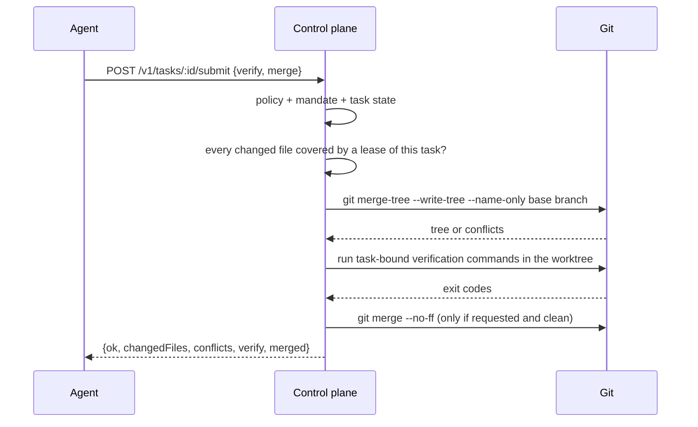

# Architecture

Teamplane is one Node process with five planes. Every plane has a narrow job and an explicit refusal. The refusals matter more than the features: they are what keeps a probabilistic component out of the decision path.

## Goals

- Let several humans and their agents work in one repository without stepping on each other.
- Make every authorization decision reproducible from recorded facts.
- Share *conclusions* across a team without sharing *conversations*.
- Fail closed, and make failures visible as events.

## Non-goals (v0.1)

- Distributed consensus or multi-writer replication.
- Semantic code understanding. The merge gate runs `git merge-tree` and your verification commands; it does not ask a model whether a diff is good.
- Being an agent runtime. It dispatches to existing runtimes (DSH, Claude Code, Cursor, Codex) over MCP.

## The five planes



### 1. Identity & authority

`Principal` (user / agent / service) holds a token; only its SHA-256 hash is stored. Roles are `owner`, `maintainer`, `agent`, `viewer`. A `Mandate` is an Ed25519-signed capability bound to one subject and one task.

The control plane never asks a model whether a principal "should" be allowed. It evaluates a pure function over `(policy, principal, roles, action, resource, fields)` and, separately, a pure function over `(mandate claims, action, resource)`.

### 2. Memory

A `MemoryFragment` is curated text with `kind`, `topic`, `visibility`, `provenance`, and `supersedes`. The write path rejects secrets and oversized fragments; the read path projects fragments through the caller's ACL. Contradictory fragments on one topic emit `memory.conflict` rather than overwriting.

There is deliberately no transcript ingestion endpoint. If a team wants a session summarised, a human or an agent must distil it into a fragment with provenance — that is the point.

### 3. Coordination

A `Task` is a unit of authorised work: repository, base branch, branch, worktree, mandate. A `Lease` is a typed key (`file:`, `dir:`, `branch:`, `memory:`) with a mode, a holder, an expiry and a monotonically increasing fencing token.

Containment is decidable:

- `dir:src/auth` conflicts with `file:src/auth/token.ts`;
- `dir:src` does **not** conflict with `file:srcx/a.ts` (boundary-aware);
- `branch:main` conflicts only with `branch:main`;
- two `shared` leases on the same key coexist; anything with an `exclusive` lease conflicts.

### 4. Execution

`task start` creates a git worktree on its own branch and writes `.teamplane/context.json`:

```json
{
  "version": 1,
  "server": "http://127.0.0.1:7317",
  "taskId": "tsk_...",
  "branch": "tp/tsk_...",
  "baseBranch": "main",
  "mandateId": "mnd_...",
  "mandate": "<signed token>",
  "paths": ["src/auth.ts"],
  "actions": ["fs.read", "fs.write"],
  "branches": ["tp/tsk_..."],
  "generatedAt": "..."
}
```

The context contains no principal token. Tokens travel through `TEAMPLANE_TOKEN`; the mandate can be shared with the worktree because it is scoped and signed.

### 5. Audit

Every mutation appends one JSON line:

```json
{"seq":42,"id":"evt_...","at":"...","type":"lease.denied","actor":"usr_...","data":{...},"prevHash":"...","hash":"..."}
```

`hash = sha256(prevHash + canonicalJSON(core))`. `teamplane audit verify` recomputes the chain. Snapshots are a cache, never the source of truth: replay verifies every event after the snapshot's sequence.

## Request flow: a write



A denial appends `decision.denied`; an `ask` appends nothing until `POST /v1/approvals`.

## Submit flow



The gate returns a result object with `ok`, never a bare error, so a caller can see *which* gate failed.

## Invariants

1. A mandate's derived scope is a subset of its parent; expiry never extends; write limits never rise.
2. A lease's fencing token is strictly greater than every previous token for the same key.
3. An expired lease can never be renewed; a released lease can never be revived.
4. A ticket/approval is single-use: consumption changes its status, and the action hash binds it to one `(action, resource, mandate)` triple.
5. A memory read never widens visibility; provenance is immutable.
6. Event hashes chain; the log is append-only and replay-verifiable.
7. The policy engine is pure: same inputs, same decision, no clock, no IO.

## Storage and recovery

```
.teamplane/
  config.json          team name, host, port, keysDir
  policy.json          editable copy; applied through the API
  events.jsonl         active segment
  archive/             rotated segments, events-<firstSeq>.jsonl
  snapshot.json        written but never trusted (safe to delete)
  memory/              memory fragments (AES-256-GCM, 0600)
```

Signing keys are **not** under `.teamplane/`: the default is `~/.teamplane/keys/<workspace-id>/root.key`, so a task worktree cannot read them by relative path.

The active segment rotates every 10,000 events (or `TEAMPLANE_SEGMENT_EVENTS`); the hash chain continues across segments, and replay/audit read archive + active in sequence order.

Startup: replay every event from genesis and verify every hash. A corrupt log refuses to start rather than serving a half-trusted state. There is one writer; the server holds an in-process mutex by construction (Node's single thread plus synchronous appends).

## Failure modes

| Failure | Behaviour |
|---|---|
| Corrupt event line | refuses to start, names the sequence |
| Snapshot forged or stale | ignored; startup replays the chain from genesis |
| Server crash mid-request | append happened or it did not; no partial state |
| Lease holder dies | lease expires; fencing token moves on |
| Approval requester disappears | approval expires; decision returns to `ask` |
| Verification hangs | per-command timeout, submit rejected |
| Git merge fails after verification | merge rejected, event recorded, branch untouched |

## Scale limits (v0.1)

Single process, single node, O(n) replay. Comfortable for tens of principals, hundreds of tasks, thousands of events. For larger deployments the log should be segmented and the projections moved to SQLite; the domain model does not change.
